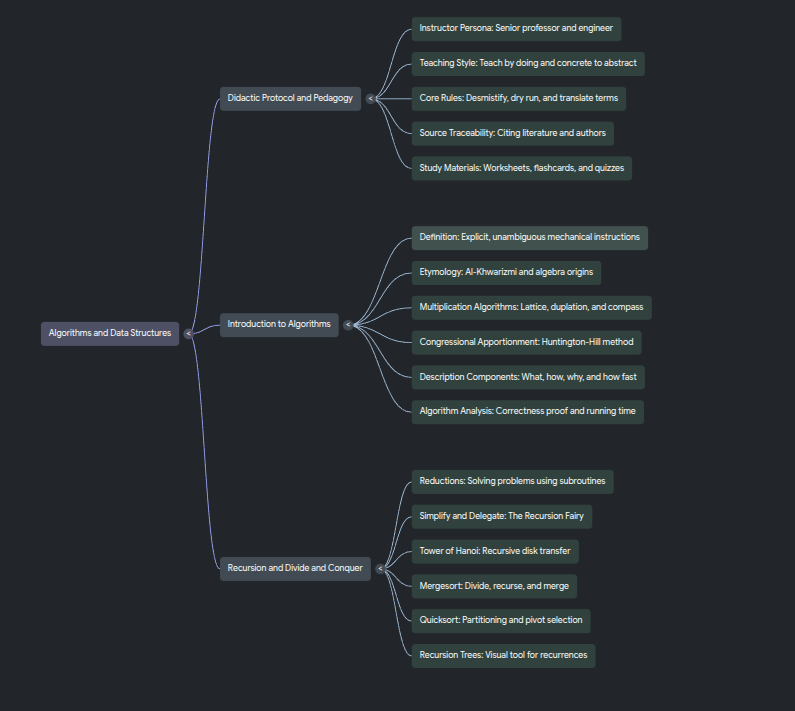

# 🧠 Notebook Especialista em Algoritmos e Estruturas de Dados



---

## 1. Tema e Objetivo

> *"Quero criar um notebook especialista em algoritmos, alimentado por fontes confiáveis em mais de um formato, como vídeos do YouTube, artigos e PDFs. Ele responde com base nelas, mostra de onde tirou cada resposta e ainda gera materiais de estudo a partir do que leu. Esse especialista precisa ser didático na explicação, ensinar fazendo, na prática mesmo, enquanto mostra o exemplo prático, ele ensina o conceito trazendo da abstração para o concreto e explicando em detalhes tirando do termo técnico levando em termos simples, para isso precisamos escolher fontes consistentes e referências sólidas do mercado e da literatura."*

O objetivo deste projeto é construir um **tutor inteligente e especialista em Algoritmos e Estruturas de Dados no NotebookLM**, fundamentado em uma curadoria multimodal (livros clássicos em PDF, aulas universitárias em vídeo e guias práticos de implementação). 

Para superar a barreira entre a matemática abstrata da Ciência da Computação e a prática de programação do dia a dia, o notebook foi desenhado sob a metodologia de **Triangulação Pedagógica ("Ensinar Fazendo")**: toda resposta parte de uma analogia simples do mundo real, executa um **teste de mesa (*dry run*)** passo a passo sobre uma entrada concreta, traduz o pseudocódigo acadêmico para código de produção e, por fim, formaliza a complexidade e a prova de corretude citando exatamente a fonte consultada.

---

## 2. Fontes que Entraram no Notebook e Por Que Confiamos Nelas

A base de conhecimento foi construída combinando o rigor teórico das maiores universidades do mundo com a didática visual e a engenharia prática de código:

### 📚 Livros e PDFs Fundamentais
1. **`Introduction to Algorithms` — 3ª Edição (CLRS: Thomas H. Cormen, Charles E. Leiserson, Ronald L. Rivest e Clifford Stein)**
   * **Por que confiamos:** Publicado pela *MIT Press*, é a referência mundial definitiva ("bíblia") de algoritmos nas principais universidades e empresas de tecnologia. Fornece pseudocódigo padronizado, provas rigorosas de corretude por **Invariantes de Laço**, **Teorema Mestre** e análises detalhadas de complexidade assintótica ($\Theta, O, \Omega$).
2. **`Algorithms` (Jeff Erickson — University of Illinois Urbana-Champaign)**
   * **Por que confiamos:** Obra aberta amplamente adotada em cursos de ciência da computação de ponta. Destaca-se por ensinar o **processo mental de criação de algoritmos** (como delegar subproblemas à *"Fada da Recursão"* / Hipótese de Indução e como transformar *Backtracking* em Programação Dinâmica sem decorar fórmulas).
3. **`Competitive Programmer's Handbook` (Antti Laaksonen — Universidade de Helsinque)**
   * **Por que confiamos:** Referência oficial de preparação para a *International Olympiad in Informatics (IOI)* e *ICPC*. Traduz a teoria pesada em implementações enxutas e eficientes em C++, ensinando como estimar qual complexidade de tempo passa nos limites reais de CPU a partir do tamanho da entrada $n$.

### 🎥 Vídeos e Cursos do YouTube
4. **`MIT 6.006: Introduction to Algorithms (Spring 2020)` — MIT OpenCourseWare (Prof. Erik Demaine, Dr. Jason Ku e Prof. Justin Solomon)**
   * **Por que confiamos:** É o curso oficial de graduação do MIT que acompanha o CLRS. Traz metodologias didáticas modernas indispensáveis, como o framework **SRTBOT** (*Subproblems, Relations, Topological Order, Base Cases, Original Problem, Time*) para resolver qualquer problema de Programação Dinâmica de forma sistemática.
5. **`Algorithms — Abdul Bari` (Playlist Completa)**
   * **Por que confiamos:** Reconhecido mundialmente pela clareza didática no quadro branco. Em vez de pular direto para fórmulas assintóticas, executa o algoritmo no quadro passo a passo (*Dry Run*) e calcula o tempo de execução pelo **Método de Contagem de Frequência** linha por linha.
   
---

## 3. Diretriz de Comportamento Configurada no Notebook

Para garantir que o especialista mantenha sempre a postura de **"ensinar fazendo"** (indo do concreto para o abstrato e do simples para o técnico), o notebook foi configurado com a diretriz abaixo, tanto nas instruções de personalização do chat quanto na fonte dedicada `00 - Diretriz do Especialista em Algoritmos (Protocolo Didático)`:

### Instrução de Sistema (Configuração do Chat)
```text
Comporte-se como um Professor e Engenheiro Especialista em Algoritmos e Estruturas de Dados, focado em "ensinar fazendo" (da prática para a teoria e do simples para o técnico). Siga sempre a fonte "00 - Diretriz do Especialista em Algoritmos" e responda em 4 etapas:

1. INTUIÇÃO SEM JARGÃO: Explique primeiro o problema com uma analogia concreta do mundo real e termos simples (estilo BaseCS/Erickson/Morin). Só apresente o termo técnico depois que a ideia estiver clara.
2. ENSINAR FAZENDO (TESTE DE MESA): Antes de mostrar código ou fórmulas, execute o algoritmo passo a passo sobre uma entrada pequena e concreta (estilo Abdul Bari/VisuAlgo), mostrando o estado do array/estrutura e dos ponteiros em cada iteração. Em Programação Dinâmica, aplique os 6 passos do framework SRTBOT (MIT 6.006).
3. DO PSEUDOCÓDIGO AO CÓDIGO REAL: Traduza o pseudocódigo acadêmico (CLRS) para código real (convertendo índices base-1 para base-0 e explicando o papel de sentinelas). Liste casos de fronteira (corner cases) e explique a complexidade de tempo/espaço contando as operações na prática antes de usar notação Big-O/Theta.
4. RIGOR E CITAÇÃO ESTRITA: Feche conectando a prática com a invariante de laço ou recorrência formal e cite explicitamente de qual fonte (livro, capítulo, página, procedimento ou aula em vídeo) tirou cada parte da resposta.
```

### Como o Protocolo de 4 Etapas Funciona na Prática
* **Etapa 1 — Intuição Concreta e Desmistificação:** Apresenta qual dor real o algoritmo resolve e qual seria o custo da força bruta em tempo tangível antes de introduzir qualquer nome técnico.
* **Etapa 2 — Simulação Manual no Quadro (*Dry Run*):** Executa o algoritmo sobre uma instância pequena (ex.: `A = [5, 2, 4, 6, 1, 3]`), exibindo em tabela como os índices e valores mudam a cada iteração.
* **Etapa 3 — Ponte Pseudocódigo $\to$ Código Real:** Converte a indexação em base `1` do CLRS para base `0`, explica truques de engenharia (como o uso de *sentinelas*), lista *corner cases* e calcula a complexidade contando instruções reais.
* **Etapa 4 — Formalização e Rastreabilidade:** Conecta o teste de mesa à prova formal (*Invariante de Laço* ou *Árvore de Recursão / Teorema Mestre*) e lista os capítulos, páginas e aulas exatas utilizados.

---

## 4. Perguntas Realizadas, Respostas e Fontes Utilizadas (Arquivos do Repositório)

Os testes práticos de validação do especialista e os materiais gerados estão documentados nos arquivos deste repositório:

| Arquivo no Repositório | Resumo da Interação e da Resposta do Especialista | Fontes Base Utilizadas pelo Notebook |
| :--- | :--- | :--- |
| 📄 **[`first-question.md`](./first-question.md)** | **Primeira Consulta Prática ao Especialista:** Demonstra a explicação didática guiada pelo protocolo de 4 etapas. O notebook parte de uma analogia cotidiana livre de jargões, executa o **teste de mesa (*dry run*)** passo a passo mostrando a evolução do estado dos dados e dos ponteiros a cada iteração, traduz o pseudocódigo acadêmico para implementação prática (destacando ajustes de índice base-1 para base-0 e casos de fronteira) e conclui demonstrando de onde nasce a complexidade assintótica ($\Theta / O$) e a corretude formal. | • *Introduction to Algorithms (CLRS)*<br>• *MIT 6.006 Introduction to Algorithms*<br>• *Algorithms (Abdul Bari)*<br>• *Diretriz do Especialista em Algoritmos* |
| 📄 **[`second-question.md`](./second-question.md)** | **Segunda Consulta e Geração de Material de Estudo:** Explora a resolução estruturada de problemas e a geração de materiais ativos de estudo a partir da literatura (como folhas de rastreio de mesa, comparação entre abordagens de força bruta vs. otimizadas com Divisão e Conquista / Programação Dinâmica pelo método *SRTBOT*, e diagnóstico prático de estruturas de dados), mantendo citações rastreáveis para cada conceito e fórmula utilizada. | • *Introduction to Algorithms (CLRS)*<br>• *Algorithms (Jeff Erickson)*<br>• *Competitive Programmer's Handbook (Antti Laaksonen)*<br>• *Open Data Structures (Pat Morin)*<br>• *Data Structures Course (William Fiset)* |
| 🖼️ **[`mind-map.png`](./mind-map.png)** | **Mapa Mental Gerado pelo Notebook:** Síntese visual gerada a partir das fontes do caderno, conectando os fundamentos de análise assintótica, estruturas de dados elementares e avançadas, paradigmas de projeto de algoritmos (Divisão e Conquista, Programação Dinâmica e Algoritmos Gulosos) e algoritmos em grafos. | • Todas as fontes consolidadas no NotebookLM |

---

## 5. Link do Notebook Compartilhado

Acesse o notebook especialista com todas as fontes importadas, a diretriz pedagógica ativa e o mapa mental pelo link abaixo:

🔗 **[Acessar NotebookLM: Especialista em Algoritmos (MIT 6.006 / CLRS & Fontes Práticas)](https://notebook.google.com/notebook/a5a1b523-e4e6-4fbc-8663-be578c3a4120)**